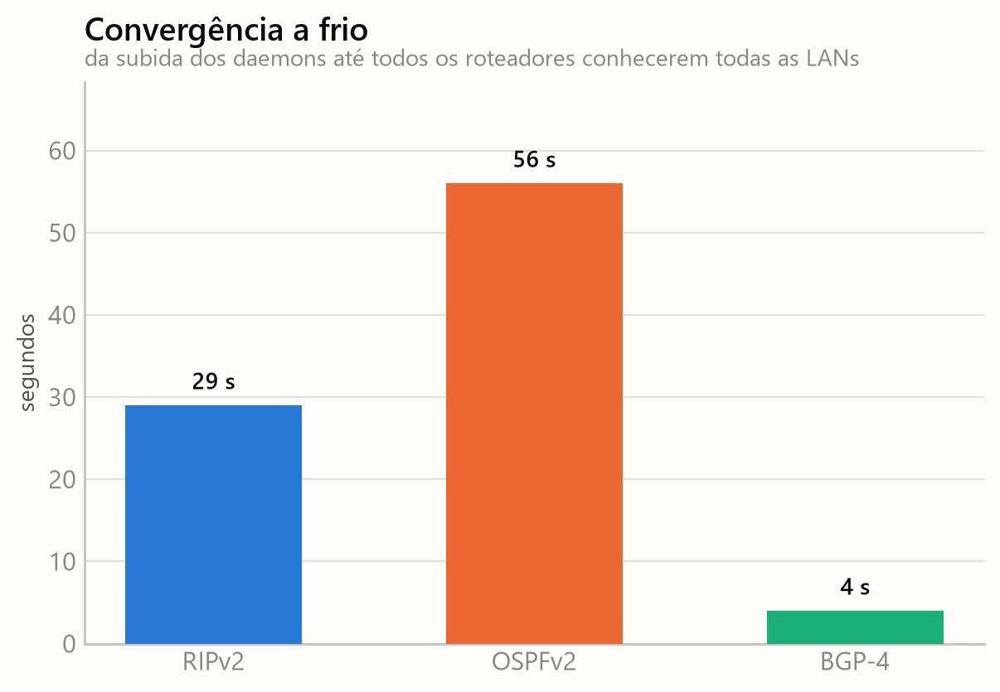
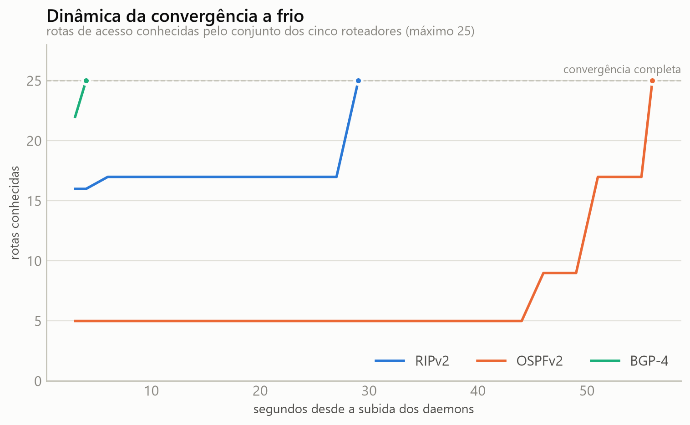
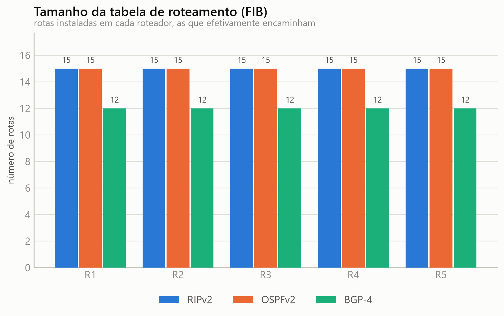
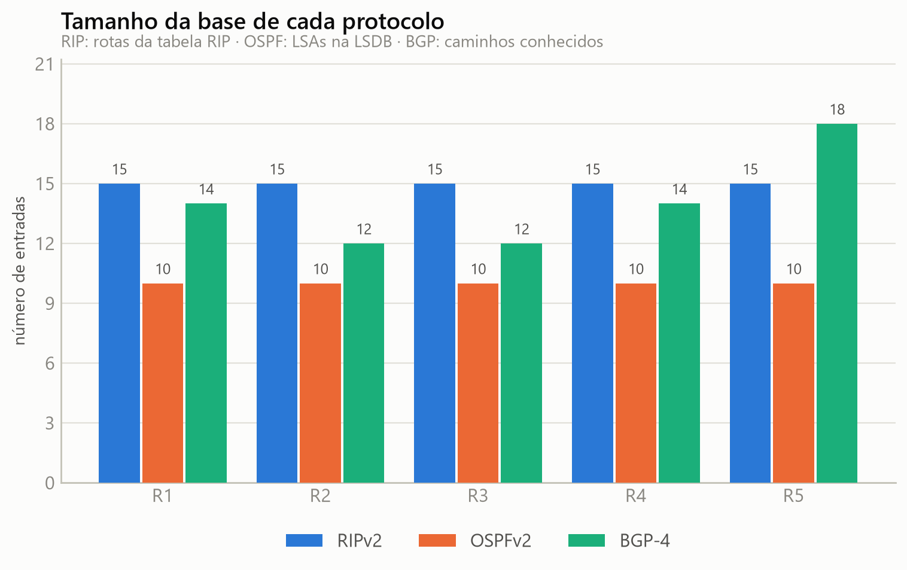
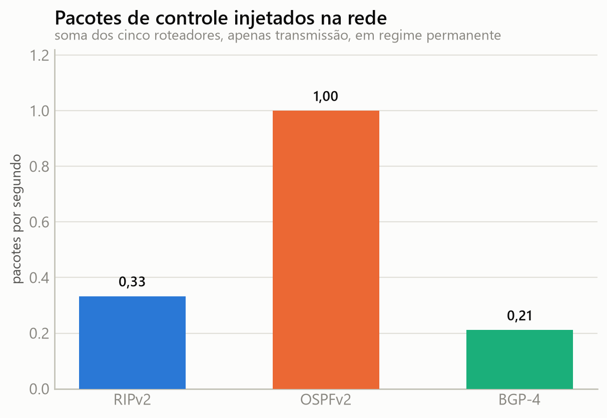
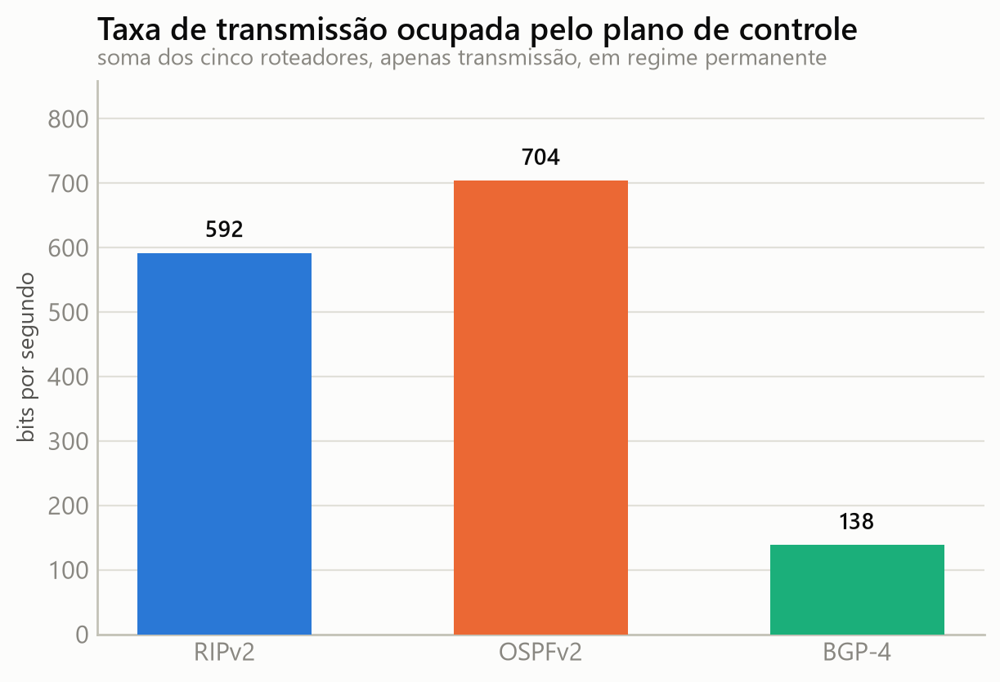
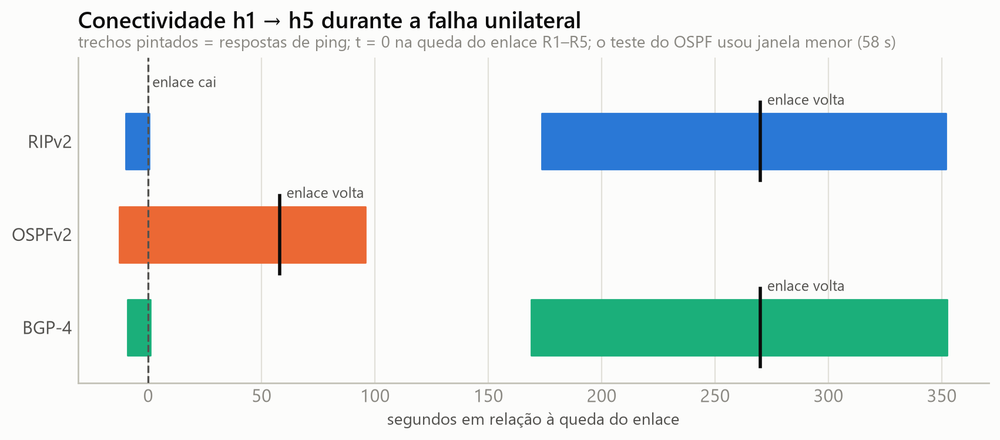
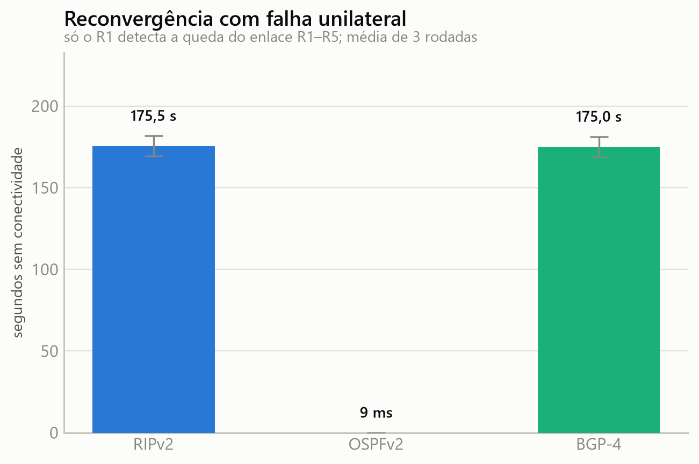
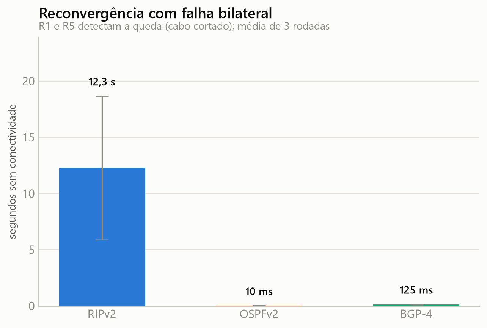
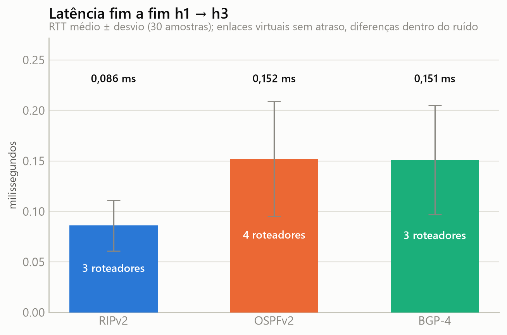

# Trabalho I — Comparação de protocolos de roteamento com FRRouting

**Redes de Computadores — UNISINOS 2026/2**
Prof. Cristiano Bonato Both · Aluno: Matheus Milanezi

Laboratório de roteamento IP com **5 roteadores em 3 Sistemas Autônomos**, sobre o
qual foram configurados e medidos **três protocolos de roteamento** RIPv2, OSPFv2
e BGP-4. Um de cada vez, sobre exatamente a mesma topologia física.

---

## 1. Plataforma de roteamento

**[FRRouting (FRR) 8.4.1](https://frrouting.org/)**, executado em containers Docker.

O enunciado cita XORP, BIRD e Quagga. O FRR é o **fork mantido do Quagga**, o
projeto Quagga está sem lançamentos desde 2018 e o FRR herdou sua base de código,
sua sintaxe de configuração (`vtysh`, estilo Cisco) e sua arquitetura de daemons
separados (`zebra`, `ripd`, `ospfd`, `bgpd`). A escolha preserva a família
indicada no enunciado e dá acesso aos três protocolos exigidos em uma única
plataforma.

Cada roteador é um container com:

| Daemon | Papel |
|---|---|
| `zebra` | gerenciador de RIB/FIB; programa as rotas no kernel |
| `ripd` / `ospfd` / `bgpd` | o protocolo em estudo — **apenas um sobe por vez** |
| `staticd` | rotas estáticas (não usado nos experimentos) |

O enunciado exige que a configuração dos três protocolos **não seja simultânea**.
Isso é garantido na origem: o `entrypoint` do container gera o arquivo
`/etc/frr/daemons` habilitando um único daemon de roteamento, conforme a variável
`PROTO`. Não há como dois protocolos coexistirem por engano.

---

## 2. Topologia física

Cinco roteadores em **anel**, cada um com sua rede de acesso e um host:

```
                                ┌──────────┐
                     ┌──────────┤    R1    ├──────────┐
                     │          └────┬─────┘          │
                     │            10.1.0.0/24         │
            172.16.15.0/29           h1         172.16.12.0/29
                     │                               │
               ┌─────┴────┐                    ┌─────┴────┐
               │    R5    │                    │    R2    │
               └─────┬────┘                    └─────┬────┘
                10.5.0.0/24                     10.2.0.0/24
                     h5                              h2
                     │                               │
            172.16.45.0/29                  172.16.23.0/29
                     │                               │
               ┌─────┴────┐                    ┌─────┴────┐
               │    R4    ├────────────────────┤    R3    │
               └─────┬────┘   172.16.34.0/29   └─────┬────┘
                10.4.0.0/24                     10.3.0.0/24
                     h4                              h3

     AS 65001: R1, R2        AS 65002: R3, R4        AS 65003: R5
```

O anel é a forma mais econômica de satisfazer a exigência de "diferentes caminhos
entre os pontos da rede": **entre quaisquer dois roteadores existem exatamente dois
caminhos disjuntos**, e a queda de qualquer enlace mantém a rede conexa. Isso é o
que torna possível medir reconvergência e observar divergência na seleção de rotas.

### Enlaces ponto a ponto

| Enlace | Prefixo | Extremo A | Extremo B | Tipo |
|---|---|---|---|---|
| R1–R2 | `172.16.12.0/29` | R1 `.1` | R2 `.2` | intra-AS 65001 |
| R2–R3 | `172.16.23.0/29` | R2 `.2` | R3 `.3` | **inter-AS** 65001↔65002 |
| R3–R4 | `172.16.34.0/29` | R3 `.3` | R4 `.4` | intra-AS 65002 |
| R4–R5 | `172.16.45.0/29` | R4 `.4` | R5 `.5` | **inter-AS** 65002↔65003 |
| R5–R1 | `172.16.15.0/29` | R5 `.5` | R1 `.1` | **inter-AS** 65003↔65001 |

> **Por que /29 e não /30?** O Docker reserva obrigatoriamente um endereço de cada
> rede bridge para o gateway. Em um /30 sobrariam apenas dois endereços úteis e um
> seria consumido pelo gateway, deixando um único endereço para os dois roteadores.
> Usa-se /29 com o gateway fixado no último endereço utilizável (`.6`), que fica sem
> uso no laboratório.

### Redes de acesso

| Rede | Prefixo | Roteador | Host |
|---|---|---|---|
| lan1 | `10.1.0.0/24` | R1 `.1` | h1 `.10` |
| lan2 | `10.2.0.0/24` | R2 `.1` | h2 `.10` |
| lan3 | `10.3.0.0/24` | R3 `.1` | h3 `.10` |
| lan4 | `10.4.0.0/24` | R4 `.1` | h4 `.10` |
| lan5 | `10.5.0.0/24` | R5 `.1` | h5 `.10` |

Cada roteador tem ainda um *loopback* `10.255.0.N/32`, usado como `router-id`.

Todas as redes são declaradas `internal: true`: o laboratório é fechado, sem NAT e
sem saída para a Internet. A rota default que o Docker instala em cada container é
removida no `entrypoint`. **Todo o encaminhamento entre LANs depende exclusivamente
do protocolo de roteamento em estudo** — não há rota estática nem default para
mascarar uma falha de configuração.

---

## 3. Topologia lógica

### 3.1 RIPv2 — vetor de distância

Métrica: **número de saltos**. Todas as redes conectadas são anunciadas; as
interfaces de LAN e o loopback são `passive` (não há vizinhos RIP nelas, e não faz
sentido inundar as redes de acesso com updates). Timers nos valores padrão
(update 30 s / timeout 180 s / garbage-collect 120 s).

### 3.2 OSPFv2 — estado de enlace

Área única (`area 0`), métrica por **custo acumulado**. Os custos foram escolhidos
deliberadamente:

| Interface | Custo |
|---|---|
| todas | 10 |
| **R2↔R3** | **200** |

O enlace R2–R3 é o caminho **mais curto em saltos** entre AS 65001 e AS 65002, mas
recebe o **maior custo OSPF**. Essa assimetria é o experimento central do trabalho:
faz com que RIP e OSPF, sobre a mesma topologia, escolham caminhos diferentes para
o mesmo destino — e permite comparar os critérios de seleção em vez de apenas
constatar conectividade.

### 3.3 BGP-4 — vetor de caminho

| AS | Roteadores | Sessões |
|---|---|---|
| 65001 | R1, R2 | iBGP R1↔R2; eBGP R2↔R3, R1↔R5 |
| 65002 | R3, R4 | iBGP R3↔R4; eBGP R3↔R2, R4↔R5 |
| 65003 | R5 | eBGP R5↔R4, R5↔R1 |

No nível de AS a topologia também é um triângulo (65001–65002–65003), de modo que
todo prefixo é alcançável por dois AS_PATHs de comprimentos diferentes.

Dois detalhes de configuração merecem registro:

- **`next-hop-self` nas sessões iBGP.** Neste cenário o BGP roda *sem IGP*. Uma
  rota aprendida por eBGP e repassada por iBGP chegaria ao par interno com um
  next-hop que ele não sabe alcançar, e seria descartada por inacessibilidade.
- **`no bgp ebgp-requires-policy`.** A RFC 8212 exige política explícita em sessões
  eBGP, e o FRR a aplica por padrão. Em laboratório a exigência é desativada para
  observar o protocolo sem filtros.

---

## 4. Como executar

### Pré-requisitos

- Docker Desktop (ou Docker Engine) com suporte a Linux containers
- Python 3.10+ com `matplotlib` (apenas para os gráficos: `pip install matplotlib`)
- Bash (no Windows, o Git Bash)

### Subir a topologia

```bash
# um protocolo por vez: rip, ospf ou bgp
./scripts/lab.sh up ospf
```

O comando constrói a imagem, sobe os 10 containers (5 roteadores + 5 hosts) e
aplica os ajustes de host descritos abaixo.

### Inspecionar

```bash
./scripts/lab.sh status              # estado dos containers e protocolo ativo
./scripts/lab.sh vizinhos            # adjacências/sessões do protocolo ativo
./scripts/lab.sh rotas r1            # tabela de roteamento de um roteador
./scripts/lab.sh caminho h1 10.3.0.10  # traceroute entre hosts
./scripts/lab.sh vtysh r1            # console do FRR (estilo Cisco)
```

### Injetar e reverter uma falha

```bash
./scripts/lab.sh falha r1 to-r5      # derruba só o lado do R1 do enlace R1–R5
./scripts/lab.sh recupera r1 to-r5   # restabelece esse lado

./scripts/lab.sh corta r2 r3         # derruba as duas pontas, como um cabo cortado
./scripts/lab.sh religa r2 r3        # restabelece as duas pontas
```

A diferença entre as duas formas de falha é um dos resultados do trabalho (seção
6.6): na falha de um lado só, RIP e BGP levam até 180 s para desviar.

### Derrubar

```bash
./scripts/lab.sh down
```

### ⚠️ Ajuste obrigatório no host Docker

RIP (`224.0.0.9`) e OSPF (`224.0.0.5`) trocam mensagens por **multicast**. Com
`bridge-nf-call-iptables=1` — o padrão — o tráfego IP que atravessa uma bridge
Linux é submetido à cadeia `FORWARD` do iptables, onde as regras padrão do Docker
o descartam.

O sintoma é enganoso: a conectividade unicast funciona (o `ping` entre roteadores
responde normalmente) e **o BGP funciona**, porque usa TCP unicast na porta 179.
Apenas RIP e OSPF ficam mudos — cada roteador enxerga somente os próprios *hellos*,
e nenhuma adjacência se forma.

O `lab.sh up` já aplica o ajuste. Para aplicá-lo isoladamente:

```bash
./scripts/lab.sh preparar-host
```

O ajuste vale até o Docker ser reiniciado. O IGMP snooping também é desativado, por
precaução; foi testado e **não** é a causa do problema.

---

## 5. Metodologia de medição

`scripts/coletar_metricas.py` executa o mesmo roteiro de seis experimentos para cada
protocolo, sobre a mesma topologia:

| # | Experimento | O que mede |
|---|---|---|
| E1 | Convergência a frio | tempo da subida dos daemons até todos os roteadores conhecerem todas as LANs |
| E2 | Tamanho da tabela | rotas instaladas (FIB) e tamanho da base de cada protocolo |
| E3 | Seleção de rota | caminho escolhido de R1 até a LAN de R3, e saltos percorridos |
| E4 | Tráfego de controle | pacotes e bits/s do plano de controle em regime permanente |
| E5 | Reconvergência | interrupção do tráfego de dados após a queda de um enlace em uso, em falha unilateral e bilateral |
| E6 | Latência fim a fim | RTT entre hosts de LANs diferentes |

```bash
python scripts/coletar_metricas.py     # ~1h30, os três protocolos
python scripts/gerar_graficos.py       # gera os PNGs em resultados/graficos/

# refazer um experimento isolado, preservando os demais resultados
python scripts/coletar_metricas.py --somente-reconvergencia --protocolos rip
python scripts/coletar_metricas.py --somente-tabelas
```

Decisões de método que afetam a validade dos números:

**Dois cenários de falha.** No teste de reconvergência o fluxo h1 → h5 passa pelo
enlace R1–R5, usado pelos três protocolos para esse destino. O enlace é derrubado
de duas formas:

- **Unilateral:** só a interface do R1 cai. A interface do R5 continua ativa, e o
  R5 só descobre a falha pelo próprio protocolo. É o caso de um defeito que um dos
  lados não enxerga (um transceptor com problema, um switch intermediário).
- **Bilateral:** as duas interfaces caem, como um cabo cortado. Os dois roteadores
  percebem a perda de enlace no mesmo instante.

O enlace fica fora por 270 s no cenário unilateral e por 60 s no bilateral. A
janela unilateral precisa ser maior que o *timeout* do RIP e o *hold timer* do BGP
(ambos de 180 s); uma primeira coleta com janela de 58 s registrou interrupções de
~58 s para RIP e BGP, que eram o tamanho da janela e não o tempo de reconvergência.
Aquela coleta está preservada em `resultados/metricas_janela58s.json`.

**Tamanho da tabela.** Contar as entradas da RIB superestima o OSPF: ele registra
uma rota para cada rede diretamente conectada, que perde para a rota conectada
(distância administrativa 0) e nunca é instalada. O E2 separa a **FIB** (rotas
instaladas, as que encaminham pacotes) da **base do protocolo** (tabela RIP, LSDB
do OSPF, caminhos BGP).

**Contagem do tráfego de controle.** A captura usa `tcpdump -Q out`: conta apenas
os pacotes **transmitidos** por cada roteador. Capturar também a recepção contaria
cada pacote duas vezes (no emissor e no receptor); restringindo à saída, a soma
sobre os cinco roteadores é exatamente o volume injetado na rede. Os bytes são os
do quadro capturado em `-i any`, que inclui o cabeçalho *Linux cooked capture* —
uma constante que afeta os três protocolos igualmente.

**Medição da interrupção.** O tempo é extraído dos carimbos do próprio `ping -D`
(50 pacotes/s, resolução de 20 ms), procurando a **maior lacuna** entre respostas
consecutivas dentro da janela do evento. A primeira versão do script media "a
primeira resposta após o instante da falha" e reportava sempre ~um intervalo de
ping para os três protocolos: o comando `docker exec` que derruba o enlace leva
algumas centenas de milissegundos para fazer efeito, de modo que o tráfego ainda
flui normalmente logo após a marcação de tempo. O erro foi detectado justamente
porque o resultado era idêntico nos três protocolos — algo que a teoria não
permitia. A perda de pacotes é contada pela **numeração ICMP**, não estimada pelo
tempo.

**Relógio.** Todas as marcações vêm do relógio do host Docker (a VM do WSL2), nunca
do relógio do Windows: misturar as duas fontes produziria intervalos sem sentido.
O `date` do BusyBox ignora `%N`, então essa referência tem resolução de 1 s — o que
basta, porque ela apenas delimita a janela de busca; a duração vem dos carimbos do
`ping`, com resolução de microssegundos.

---

## 6. Resultados

Dados brutos em [`resultados/metricas.json`](resultados/metricas.json); tabelas em
`resultados/*.csv`; gráficos em [`resultados/graficos/`](resultados/graficos/).

### 6.1 Resumo

| Métrica | RIPv2 | OSPFv2 | BGP-4 |
|---|---|---|---|
| Caminho de R1 até a LAN de R3 | via R2 (3 roteadores) | via R5 (4 roteadores) | via R2 (3 roteadores) |
| Convergência a frio | 29 s | 56 s | **4 s** |
| Rotas instaladas (FIB) | 15 | 15 | 12 |
| Base do protocolo | 15 rotas | 10 LSAs | 12 a 18 caminhos |
| Tráfego de controle | 0,333 pkt/s · 592 bit/s | 1,000 pkt/s · 704 bit/s | **0,211 pkt/s · 139 bit/s** |
| Reconvergência, falha unilateral | 175,5 s | **9 ms** | 175,0 s |
| Reconvergência, falha bilateral | 12,3 s | **10 ms** | 125 ms |
| RTT h1 → h3 | 0,086 ms | 0,152 ms | 0,151 ms |
| Linhas de configuração por roteador | **9** | 12 | 15 a 16 |

Os RTTs estão na tabela por completude, mas as diferenças são ruído (seção 6.7).

### 6.2 Seleção de rota: o mesmo destino, dois caminhos

Rota de R1 até a LAN de R3 (`10.3.0.0/24`), com cada protocolo:

| Protocolo | Próximo salto | Caminho (traceroute) | Métrica | Critério |
|---|---|---|---|---|
| RIPv2 | R2 | R1 → R2 → R3 | 3 saltos | menor número de saltos |
| OSPFv2 | R5 | R1 → R5 → R4 → R3 | custo 40 | menor custo acumulado |
| BGP-4 | R2 | R1 → R2 → R3 | AS_PATH `65002` | AS_PATH mais curto |

É o resultado central do trabalho. Sobre a mesma topologia física, **RIP e OSPF
escolhem caminhos diferentes**, e cada escolha é explicada pelo critério do
protocolo:

- O RIP enxerga apenas saltos. Pelo R2 são 3, pela volta são 4, e ele vai pelo R2
  sem saber que o enlace R2–R3 é o mais caro.
- O OSPF enxerga custo. Pelo R2 o custo seria 10 + 200 + 10 = **220**; pela volta,
  10 + 10 + 10 + 10 = **40**. Ele atravessa um roteador a mais para evitar o
  enlace caro.
- O BGP não enxerga nem saltos nem custo de enlace. No R1 existem dois caminhos
  para o prefixo: AS_PATH `65002` (via R2) e `65003 65002` (via R5). Vence o
  AS_PATH mais curto. A coincidência com o RIP é de resultado, não de critério: se
  o AS 65002 tivesse vinte roteadores internos, o BGP continuaria vendo "um AS".

### 6.3 Convergência a frio




| Protocolo | Tempo até todos os roteadores conhecerem as 5 LANs |
|---|---|
| RIPv2 | 29 s (68 s em outra subida) |
| OSPFv2 | 56 s |
| BGP-4 | 4 s |

A curva explica cada número melhor que a barra:

- **BGP (4 s).** A sessão TCP sobe assim que os daemons iniciam e os UPDATEs são
  enviados em seguida. Não há período de espera.
- **OSPF (56 s).** A curva fica parada em 5 rotas (só as conectadas) por mais de
  40 s e então sobe em degraus. Os enlaces são redes Docker do tipo *broadcast*, e
  nesse tipo de rede o OSPF permanece no estado `Waiting` durante o *wait timer*
  (igual ao *dead interval*, 40 s) antes de eleger o DR. Esse estado apareceu na
  inspeção das interfaces (`State Waiting`). Configurar os enlaces como
  `ip ospf network point-to-point` eliminaria a eleição e essa espera.
- **RIP (29 s).** Ao iniciar, cada roteador pede a tabela dos vizinhos, que
  respondem na hora: por isso a curva já começa em 16 rotas. O restante depende do
  próximo update periódico (a cada 30 s) propagar as rotas pelo anel. O resultado
  depende da fase desse timer; em outra subida o mesmo RIP levou 68 s. O E1 é uma
  amostra única por protocolo, e no RIP a variação entre execuções é grande.

### 6.4 Tamanho da tabela de roteamento




| Protocolo | FIB (instaladas) | RIB (entradas) | Base do protocolo |
|---|---|---|---|
| RIPv2 | 15 | 15 | 15 rotas na tabela RIP |
| OSPFv2 | 15 | 19 | 10 LSAs na LSDB |
| BGP-4 | 12 | 12 | 12 a 18 caminhos (R5: 18) |

Os valores são iguais nos cinco roteadores, exceto a base do BGP.

- **RIP e OSPF instalam os mesmos 15 prefixos**: 5 LANs, 5 loopbacks e 5 enlaces.
  O BGP instala 12, porque cada roteador só anuncia a própria LAN e o próprio
  loopback. Os enlaces de trânsito entre ASes não são anunciados, e nenhum
  roteador conhece os /29 remotos. É uma decisão de configuração, não um limite
  do protocolo.
- **A RIB do OSPF tem 19 entradas** porque ele registra uma rota para cada uma das
  4 redes diretamente conectadas do roteador. Essas entradas perdem para a rota
  conectada e nunca são instaladas.
- **A LSDB do OSPF descreve a topologia, não as rotas.** Os 10 LSAs são 5
  *router-LSAs* (um por roteador) e 5 *network-LSAs* (um por enlace broadcast com
  DR). O número é idêntico nos cinco roteadores porque a LSDB é sincronizada em
  toda a área: cada roteador calcula as próprias rotas a partir do mesmo mapa.
- **O BGP guarda caminhos alternativos.** O R5, único roteador com duas sessões
  eBGP, conhece dois caminhos para cada prefixo remoto: 8 prefixos × 2 caminhos,
  mais os 2 que ele mesmo origina, dão 18. Os roteadores que só aprendem por iBGP
  recebem apenas o melhor caminho do par. É esse estoque de alternativas que
  permite ao BGP trocar de caminho instantaneamente na falha bilateral (6.6), e é
  também o que faz sua memória crescer com o número de vizinhos multiplicado pelo
  número de prefixos.

### 6.5 Tráfego de controle em regime permanente




Janela de 90 s, soma dos 5 roteadores, apenas transmissão:

| Protocolo | Pacotes/s | bit/s | Bytes/pacote | Previsto pela teoria |
|---|---|---|---|---|
| RIPv2 | 0,333 | 592 | 222 | 10 interfaces × 1 update/30 s = **0,333** |
| OSPFv2 | 1,000 | 704 | 88 | 10 interfaces × 1 hello/10 s = **1,000** |
| BGP-4 | 0,211 | 139 | 82 | 10 pontas × 1 keepalive/60 s = 0,167 + ACKs do TCP |

**Os números medidos coincidem com os timers configurados**, o que valida a própria
coleta: RIP e OSPF batem exatamente com a previsão, e o BGP fica um pouco acima
porque cada keepalive gera um ACK TCP que também passa pela porta 179.

O que os números dizem sobre escalabilidade:

- O **OSPF** envia 3× mais pacotes que o RIP, mas pacotes pequenos (88 B): os
  hellos só confirmam que o vizinho está vivo, e seu tamanho não depende do
  tamanho da rede.
- O **RIP** envia poucos pacotes, mas grandes (222 B), porque **cada update leva a
  tabela inteira**. O custo em bytes cresce com o número de rotas e é pago a cada
  30 s, mesmo sem mudança nenhuma. Neste laboratório pequeno o RIP já gasta 84% do
  que o OSPF gasta em bits; com uma tabela maior, passaria à frente.
- O **BGP** é o mais barato em regime permanente: sem mudanças, só keepalives.
  Atualizações são incrementais e só acontecem quando algo muda.
- A janela de 90 s não captura o *refresh* das LSAs do OSPF (a cada 30 min) nem
  inundações por mudança de topologia; ela mede apenas o custo de manutenção.

### 6.6 Reconvergência após falha de enlace

Fluxo h1 → h5 (50 pings/s) enquanto o enlace R1–R5, usado pelos três protocolos
para esse destino, é derrubado. Três rodadas por cenário.



| Protocolo | Falha unilateral | Falha bilateral |
|---|---|---|
| RIPv2 | 175,5 s ± 6,2 (171 a 183 s) | 12,3 s ± 6,4 (5 a 17 s) |
| OSPFv2 | **9 ms**, nenhum pacote perdido | **10 ms**, nenhum pacote perdido |
| BGP-4 | 175,0 s ± 6,2 (168 a 179 s) | 125 ms (4 a 5 pacotes perdidos) |




**Na falha unilateral só o R1 percebe a queda.** A interface do R5 continua
`UP, LOWER_UP` e ele segue mandando as respostas de h5 para o R1 pelo enlace morto.
A pergunta que separa os protocolos é: *como o R5 descobre?*

- **OSPF: não precisa descobrir.** O R1 inunda um novo *router-LSA* sem o enlace
  para o R5, e esse LSA chega ao R5 pela volta do anel em milissegundos. No cálculo
  do SPF, um enlace só é usado se os LSAs dos **dois** roteadores o anunciarem
  (verificação bidirecional da RFC 2328). O anúncio do R5 ainda cita o R1, mas o do
  R1 não cita mais o R5, então a aresta é descartada. Nenhum pacote perdido em seis
  rodadas.
- **RIP: descobre pelo timeout.** O update disparado do R1 não tem como chegar ao
  R5, e o R5 mantém a rota para `10.1.0.0/24` via R1, que tem métrica melhor que o
  anúncio do R4, até ela expirar: **180 s** sem updates. Os 171 a 183 s medidos
  são esse timeout, descontado o tempo desde o último update do R1 e somada a espera
  pelo próximo update do R4.
- **BGP: descobre pelo hold timer.** A sessão eBGP do R5 com o R1 continua aberta
  até o *hold timer* vencer, **180 s** após o último keepalive recebido. O caminho
  alternativo via R4 já estava guardado; quando a sessão cai, a troca é imediata.
  Os 168 a 179 s são o hold timer, descontado o tempo desde o último keepalive.
  Durante o teste o plano de controle do R1 já tinha reconvergido em menos de 5 s
  (`show ip bgp` mostrava `65002 65003` via R2): o tráfego parado era só o de volta.

**Na falha bilateral os dois lados perdem o enlace.**

- **BGP (125 ms):** as duas sessões eBGP caem na hora (*fast external failover*).
  O R5 já tinha o caminho alternativo; o R1 precisa apenas de um UPDATE iBGP do R2
  com o caminho `65002 65003`.
- **RIP (12,3 s, de 5 a 17 s):** os dois lados descartam as rotas e mandam updates
  disparados, mas quem tem o caminho alternativo não o anunciava antes. O RIP guarda
  só a melhor rota, e o *split horizon* impede o R2 de anunciar ao R1 uma rota que
  aprendeu dele. A alternativa só chega no próximo update periódico do vizinho, a
  cada 30 s, e daí a variação entre as rodadas.
- **OSPF (10 ms):** o mesmo mecanismo do caso unilateral.

**Conclusão: a detecção da falha pesou mais que o protocolo.** O mesmo RIP levou
14× mais tempo com a falha unilateral; o mesmo BGP, 1400× mais. Só o OSPF, que
confirma o enlace pelos dois lados, é imune à diferença. Em redes reais é para isso
que existe o BFD (*Bidirectional Forwarding Detection*), que o FRR suporta e que
derrubaria a sessão BGP em frações de segundo. Configurá-lo seria o próximo
experimento.

### 6.7 Latência fim a fim



O RTT de h1 a h3 ficou entre 0,09 e 0,15 ms nos três protocolos. **Essa diferença
é ruído, não efeito do caminho**: RIP e BGP usam exatamente o mesmo caminho até h3 e
ainda assim diferem em 0,065 ms, e para h1 → h5, onde os três usam o mesmo caminho
direto, as médias variam de 0,082 a 0,155 ms. Os mínimos ficam todos perto de
0,055 ms.

Os enlaces são interfaces virtuais sem atraso configurado, então o encaminhamento
por um roteador a mais custa microssegundos, abaixo da variação do agendamento do
sistema. Para que o RTT separasse os caminhos seria preciso emular atraso nos
enlaces (por exemplo com `tc netem`), o que ficou fora do escopo.

### 6.8 Comparação e adequação a cenários

| | RIPv2 | OSPFv2 | BGP-4 |
|---|---|---|---|
| Princípio | vetor de distância | estado de enlace | vetor de caminho |
| Seleção de rota | menos saltos | menor custo acumulado | AS_PATH mais curto e políticas |
| Mudança de topologia | lenta; depende de timers de 30 s e 180 s | a mais rápida; não depende do vizinho perceber a falha | rápida se a falha é detectada, 180 s se não |
| Consumo de controle | tabela inteira a cada 30 s | hellos a cada 10 s e inundação de LSAs nas mudanças | só keepalives em regime; updates incrementais |
| Escalabilidade | limite de 15 saltos; custo cresce com a tabela | LSDB cresce com a topologia; áreas para dividir | escala para a Internet; memória cresce com vizinhos × prefixos |
| Configuração | 9 linhas: lista as redes | 12 linhas: redes e custos a planejar | 15 a 16 linhas: vizinhos, ASNs, next-hop |
| Onde faz sentido | redes pequenas e estáveis, sem enlaces de capacidades diferentes | roteamento interno de uma organização | roteamento entre Sistemas Autônomos |

A "configuração" conta as linhas específicas do protocolo em cada roteador,
excluindo o cabeçalho comum.

Os três protocolos não disputam o mesmo lugar. RIP e OSPF são **IGPs**, escolhidos
pela qualidade do caminho dentro de uma organização; o BGP é um **EGP**, que decide
por política entre organizações e não enxerga o que acontece dentro de cada AS.
Neste laboratório o BGP funcionou sozinho graças ao `next-hop-self`, mas numa rede
real ele rodaria **junto** com um IGP: OSPF dentro de cada AS e BGP nas fronteiras.

Entre os dois IGPs, os experimentos favorecem o OSPF em tudo que importa numa rede
com redundância: ele escolheu o caminho de menor custo em vez do de menos saltos e
foi o único imune à falha que o vizinho não enxerga. O preço é pagar mais pacotes
de controle em regime e ter uma convergência inicial mais lenta nas redes
broadcast. O RIP só leva vantagem na simplicidade de configuração.

---

## 7. Estrutura do repositório

```
.
├── docker-compose.yml          topologia física (gerado)
├── docker/
│   ├── Dockerfile.router       imagem FRR + ferramentas de medição
│   └── entrypoint-router.sh    renomeia interfaces, seleciona o daemon
├── configs/                    15 configurações FRR (5 roteadores × 3 protocolos)
├── scripts/
│   ├── gerar_topologia.py      fonte única da topologia → compose + configs
│   ├── lab.sh                  orquestração (up/down/falha/inspeção)
│   ├── coletar_metricas.py     os seis experimentos
│   └── gerar_graficos.py       gráficos comparativos
└── resultados/
    ├── metricas.json           dados brutos
    ├── metricas_janela58s.json coleta anterior, com a janela de falha curta demais
    ├── *.csv                   tabelas
    └── graficos/               PNGs
```

`docker-compose.yml` e `configs/*.conf` são **gerados** por
`scripts/gerar_topologia.py` a partir de uma única tabela de topologia. Manter um
gerador evita divergência entre o endereçamento do Docker, o mapa de interfaces
usado pelo `entrypoint` e as vizinhanças configuradas no FRR. Para alterar a
topologia, edite o gerador e rode:

```bash
python scripts/gerar_topologia.py
```

### Nomes de interface estáveis

O Docker nomeia as interfaces (`eth0`, `eth1`, …) em ordem não garantida, o que
tornaria frágil qualquer configuração que as referenciasse por nome. O `entrypoint`
renomeia cada interface a partir do endereço IPv4 atribuído, de modo que as
configurações do FRR usam nomes estáveis e legíveis: `lan`, `to-r2`, `to-r5`.

---

## 8. Vídeo

**Vídeo da demonstração:** [adicionar o link do vídeo]

---

## 9. Uso de IA

**Ferramenta:** Claude (Anthropic), via Claude Code.

**Onde foi usada:** construção do laboratório (Dockerfile, `entrypoint`, gerador de
topologia, configurações FRR), scripts de coleta e de gráficos, e apoio na redação desta
documentação.

Toda hipótese da IA foi tratada como previsão e só entrou nesta documentação
depois de verificada no laboratório. Quatro delas estavam erradas ou incompletas,
e as correções mudaram os resultados:

**1. Por que RIP e OSPF não formavam adjacência.** A IA supôs IGMP snooping nas
bridges do Docker. O teste mostrou que não: adjacências já estabelecidas
sobreviviam com o snooping ligado. Capturas nas duas pontas de um enlace mostraram
que cada roteador via apenas os próprios *hellos*, e a causa real era o
`bridge-nf-call-iptables` (seção 4).

**2. A reconvergência igual nos três protocolos.** A primeira coleta devolveu
exatamente 0,056 s para os três, o próprio intervalo entre pings. A IA tinha
escrito o script para medir "a primeira resposta após o instante da falha", mas o
comando que derruba o enlace leva centenas de milissegundos para fazer efeito, e
nesse meio-tempo o tráfego ainda fluía. O desvio foi verificado à mão na topologia
real (`show ip route`, `traceroute`, ping contínuo com 900 de 900 respostas no
OSPF) e o método foi corrigido para buscar a **maior lacuna** entre respostas.

**3. RIP e BGP "presos" em 58 s.** Com a medição corrigida, RIP e BGP registraram
~58 s de interrupção, que era o tamanho da janela do teste. A hipótese inicial da
IA foi que os protocolos não reconvergiam. A inspeção ao vivo mostrou outra coisa:
o plano de controle do R1 reconvergia em menos de 5 s, mas a interface do R5
continuava ativa, e o R5 nunca soube da falha. A janela foi ampliada para 270 s,
acima dos timers de 180 s, e foi acrescentado o cenário bilateral. Os resultados
da seção 6.6 (175 s contra 12 s no RIP; 175 s contra 0,125 s no BGP) só existem
por causa dessa correção.

**4. Tamanho da tabela e latência.** A primeira versão do E2 contava entradas da
RIB, o que dava 19 rotas para o OSPF contra 15 dos demais; eram 4 entradas nunca
instaladas. E a primeira versão do gráfico de latência atribuía a diferença de RTT
ao caminho, até se notar que RIP e BGP usam o mesmo caminho e diferem tanto quanto
os outros.

Os dados da coleta com a janela curta estão preservados em
`resultados/metricas_janela58s.json`.
